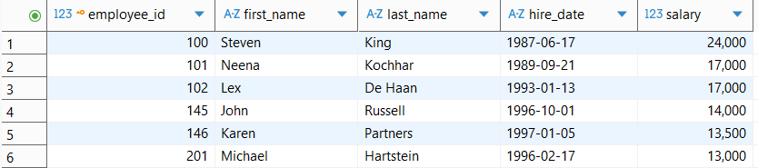
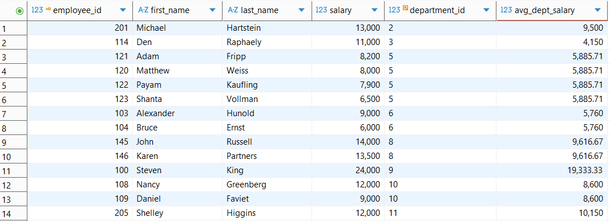

# Subqueries and CTEs

## Overview
In this demo, we will be using [DBeaver Community Edition](https://dbeaver.io/download/) to write some queries using the employee_small.db to demonstrate how to use subqueries and CTEs. Click [here](https://drive.google.com/file/d/1g1lfZEIL9hyTLIR143DdRzcMJY2DwSQM/view?usp=sharing) to download the starter `.sql` file for this demo.

### Question 1

Write a query that returns all employees that make more than 50% of the highest paid employee in the company. Order by salary in descending order and then by hire date in ascending order.

Here is the output:

### Question 2

Write a query that returns all employees whose salary is higher than the average salary of all employees in their department. Order the results by department_id in ascending order and salary in descending order.

We will tackle this question 4 different ways:

1. Subquery with a JOIN
2. Correlated subquery
3. CTE with a JOIN
   
The preferred option should be based on query performance and column requirements for the output.

!!! tip "Pin Tabs"
    Demonstrate how to pin output tabs in DBeaver!

Here is the output:

## Conclusion

In this demo, we used DBeaver to write some advanced SQL queries.