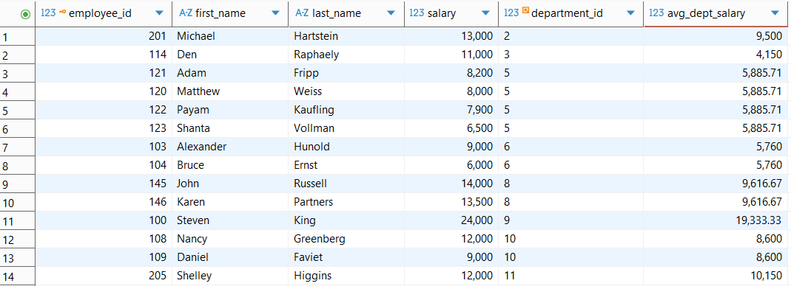
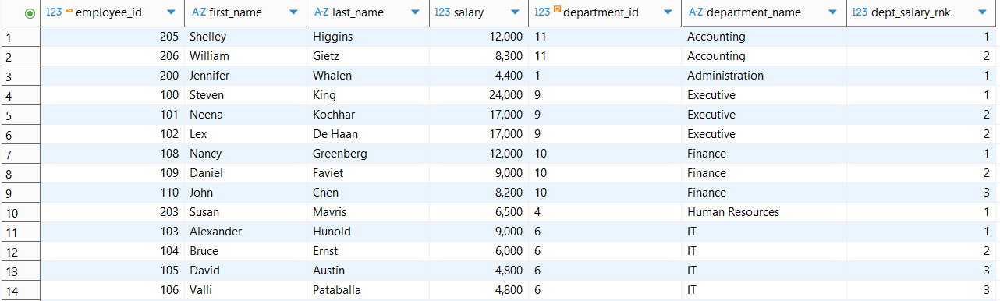
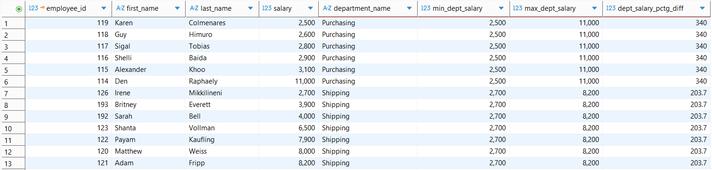
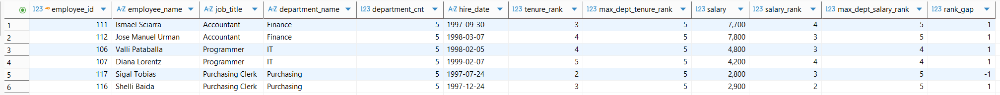

# Window Functions

## Overview
In this demo, we will continue using [DBeaver Community Edition](https://dbeaver.io/download/) to write some queries using the employee_small.db to demonstrate how to use subqueries, CTEs, and window functions to tackle some interesting questions. Click [here](https://drive.google.com/file/d/1N763R7hJ_2-mOoeNuYmzTm2vqXxVjJJg/view?usp=sharing) to download the starter `.sql` file for this demo.

In the Subqueries and CTEs demo, we approached the same question three different ways using:

1. Subquery with a JOIN
2. Correlated subquery
3. CTE with a JOIN

Next, we will add in a third option with an aggregate and window function. The preferred option should be based on query performance and column requirements for the output.

### Question 1

Write a query that returns all employees whose salary is higher than the average salary of all employees in their department. Order the results by department_id in ascending order and salary in descending order.

Include `employee_id`, `first_name`, `last_name`, `salary`, `department_id`, and calculated column `avg_dept_salary`.

Here is the output:

### Question 2

Write a query that returns the top 3 employees based on salary in each department. Assign ranks sequentially with no gaps in the case of ties. Order by department name in ascending order and then salary in descending order.

Include `employee_id`, `first_name`, `last_name`, `salary`, `department_id`, `department_name`, and calculated column `dept_salary_rnk`.

Here is the **sample** output:

!!! tip "Ranking Function Differences"
    Demonstrate the difference in output for the three ranking window functions!

### Question 3

Write a query that returns all employees that work in a department that has a 200% difference between the min and max salary in the department. Return the min and max department salary as well as the department salary % difference. Round the percentage to 2 decimal places and express as a percentage but without the % sign.

*We will tackle this question using chained CTEs.*

!!! tip "Analytic Function Differences"
    Demonstrate the difference in output for `FIRST_VALUE()` and `LAST_VALUE()` window functions!

Include `employee_id`, `first_name`, `last_name`, `salary`, `department_name`, and calculated columns `min_dept_salary`, `max_dept_salary`, and `dept_salary_pctg_diff`.

Here is the output:

### Question 4

Write a query that returns all employees whose absolute rank gap is 1 or greater, calculated by subtracting their salary rank from their tenure rank within their department. A rank of 1 for both means the employee has the longest tenure and highest salary in their department. Do not include any employees that have Manager or President in their job title. Include only departments that had at least 2 employees that were considered in the ranking calculations for each department and include that count in the output. You also must include the max value for each department ranking field. Order by department name in ascending order, hire date in ascending order, and salary in descending order.

!!! note
    This question does not explicitly specify which ranking function to use. You should be able to determine the appropriate function by examining the sample output. You are also encouraged to experiment with different ranking functions and compare the results to better understand their differences.

Include `employee_id`, calculated `employee_name`, `job_title`, `department_name`, calculated `department_cnt`, `hire_date`, calculated `tenure_rank`, calculated `max_dept_tenure_rank`, `salary`, calculated `salary_rank`, calculated `max_dept_salary_rank`, and calculated `rank_gap`.

Here is the output:

## Conclusion

In this demo, we used DBeaver to write some advanced SQL queries.